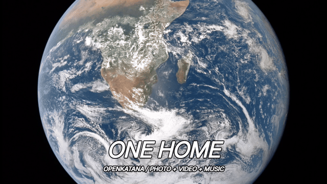
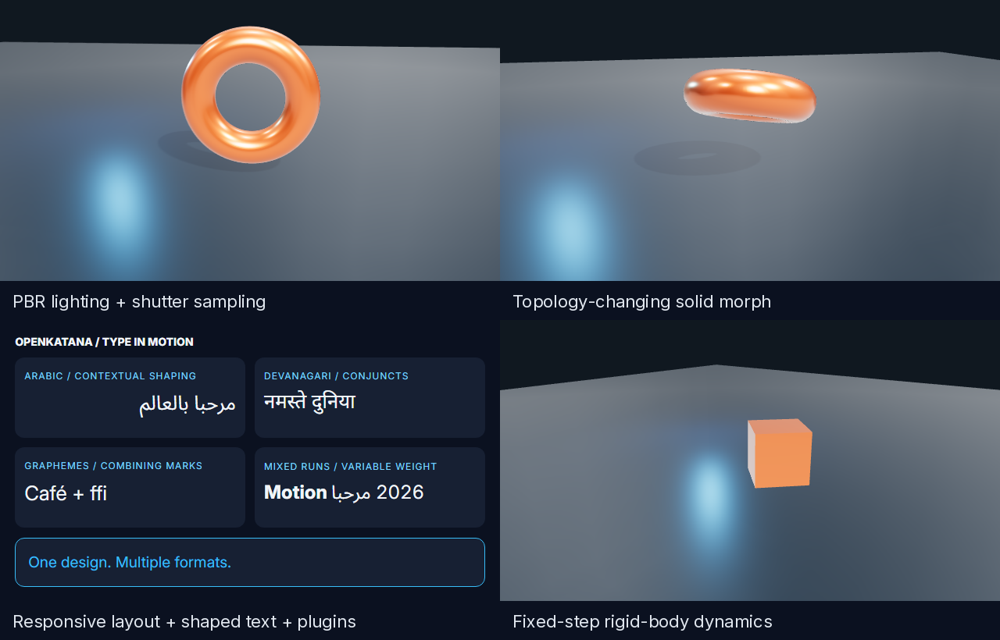

# OpenKatana

**Your photos and videos, made into a finished edit.** OpenKatana is an independent,
open-source video editor for you and your AI agent: cuts, transitions, motion,
typography and music in one shared project. Built with the Comfy Developer Platform,
with local open-weights workflows and optional authorized API models. **Version 0.1.0.**



*One home — an actual local render using bundled NASA imagery and an original
score. [Run it and inspect the credits](examples/quick-edit/README.md).
The GIF is silent; the rendered MP4 includes music.*

## Start with your agent

Copy this into an agent with local file and terminal access.

```text
Set up OpenKatana so we can create and edit videos together.

Clone https://github.com/rk0neki/OpenKatana.git, or reuse my existing checkout.
Read docs/SETUP.md and run python scripts/setup.py from the repository.
Use python3 if that is the Python 3.11+ command on my system.

Load the openkatana-video skill installed in the project's .agents/skills folder.
Use the environment and project reported by setup. Check doctor and
get_capabilities, explain missing dependencies, and open Studio.

Use the CLI for editing and local execution by default. Ask before model
downloads, paid jobs, uploads or publishing. Do not generate anything during
setup. Tell me when the CLI and skill are ready.
```

No agent? After [setup](docs/SETUP.md), activate the environment and run:

```sh
python examples/quick-edit/render.py
```

This renders the eight-second edit above from bundled assets. No AI account,
model download or network call is needed after setup. The command prints the MP4
path and keeps an editable project. [Manual setup and dependencies](docs/SETUP.md).

## Direct, refine, export

1. **Bring a brief and media.** Your agent can author the edit, or start from a
   recipe such as beat montage, travel diary, split collage or ramp and freeze.
2. **Refine in Studio.** Review frames, change shots and sound, explore tool guides
   and share a brief with your agent. Revision checks protect unsaved human edits.
3. **Render and review.** Export video with music, inspect motion and iterate.

72 shared CLI/MCP tools cover footage selection, retiming, transitions, masks,
camera moves, beat analysis, audio mixing, typography and render review.
Your agent supplies the creative direction; the tools execute it.

## ComfyUI Apps and model-to-edit graphs

After setup, use OpenKatana's Python to install the pack, then restart ComfyUI:

```sh
python scripts/install_comfy_nodes.py --comfy-root PATH_TO_COMFYUI
```

Five saved Apps provide **Open Studio**, **All tools**, **Make a 3D scene**,
**Background job** and **Video to edit**. The pack has 82 nodes: all 72 shared
tools plus project, job, media and image helpers. A Manager Git-URL install also
loads the repository root; the separate runtime still needs setup.

Connect a model's decoded **IMAGE** frames or **VIDEO** output directly:

```text
Local model → Import media → Make edit → Render to video → VIDEO + preview frames
                 ↑ AUDIO (optional)
```

For a concrete open-weights example, [LTX to edit](examples/comfy/README.md)
connects sampling and decoding to a ramp/freeze edit. The graph schema is checked
against ComfyUI; LTX inference requires separately installed weights and has not
been run in this validation round. The typed media path was tested end to end
with synthetic frames, interpolation, music and a rendered VIDEO round-trip.
Existing model adapters have separate [recorded validation](docs/model-validation.json).

These nodes run locally and reject cloud/paid jobs. The CLI and agent route can
use authorized Comfy API jobs separately. Studio, CLI and optional stdio MCP
share the same files. [Apps, typed ports and installation](docs/COMFY_APPS.md).

## Also included



- **3D and animation:** WebGL scenes, PBR lighting, glTF rigs and morphs, physics,
  custom Three.js modules, or separately installed Blender.
- **Motion graphics:** responsive Flex/Grid layouts, multilingual shaping,
  glyph contours, reusable plugins and 26 bundled OFL fonts.
- **Finishing:** HDR conformance/export, masks, restoration, previews and motion
  analysis. Model-dependent tools require their own models and nodes.

Try a model-free WebGL render:

```sh
openkatana scene3d init my-scene --template morph
openkatana scene3d render my-scene/scene.json --out my-scene/render-001
```

### Experimental hosted pilot

The [hosted pilot](docs/HOSTING.md) prepares account workspaces, queued rendering
and remote MCP. **It is experimental and not deployed.** Production identity,
isolation, backups and model services need deployment-specific validation.
There is no hosting bill for the local app. See [security](SECURITY.md) and
[hosting costs](docs/HOSTING-COSTS.md).

## Documentation and compatibility

- [Setup](docs/SETUP.md) · [Studio](docs/STUDIO.md) · [Agent guide](docs/AGENT_INTERFACE.md)
- [Timeline](docs/TIMELINE.md) · [Editor tools](docs/EDITOR_TOOLS.md) · [Effects](docs/EXPANSION.md)
- [3D](docs/SCENE3D.md) · [WebGL](docs/WEBGL.md) · [Blender](docs/ANIMATION.md)
- [Compositions](docs/COMPOSITIONS.md) · [HDR](docs/HDR.md) · [Models](docs/COMFY_MODELS.md)
- [Capabilities](docs/CAPABILITY-MATRIX.md) · [Limits](docs/CAPABILITY-GAPS.md) · [Validation](docs/VALIDATION.md)
- [Contributing](CONTRIBUTING.md) · [Skill](skills/openkatana-video/SKILL.md) · [Release notes](docs/RELEASE-NOTES.md)

Windows is tested locally. CI covers Windows and Linux on Python 3.11 and 3.12;
check the completed runs for the commit you install. **macOS is untested.**
Python 3.11+ is required. FFmpeg, Chromium, optional Blender and generative weights
are separate installations. Playwright's installed Chromium is a supported
browser fallback. Studio is not a full graphical 3D scene editor.

## License

OpenKatana uses [Apache-2.0](LICENSE). Bundled components retain their own licenses
and notices; see [NOTICE](NOTICE) and [third-party notices](THIRD_PARTY_NOTICES.md).
External software, models and media have separate terms. The project license
does not grant rights to them or guarantee legal clearance. See [licensing](docs/LICENSING.md).
