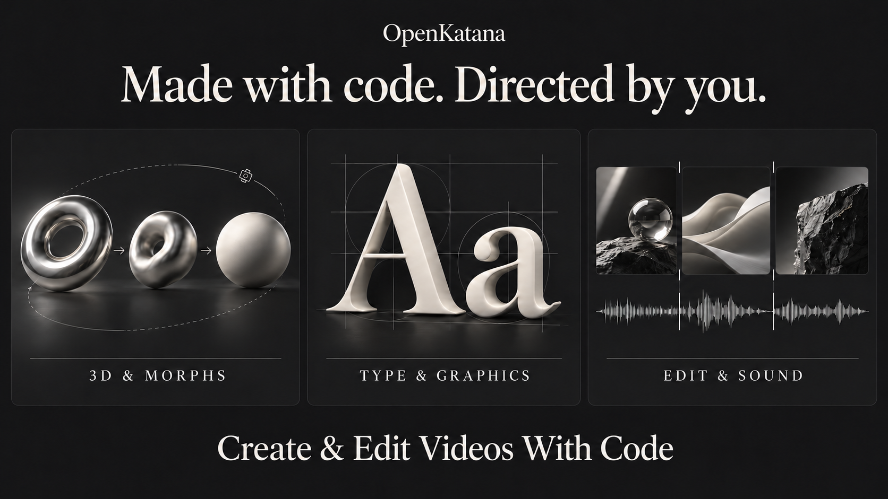
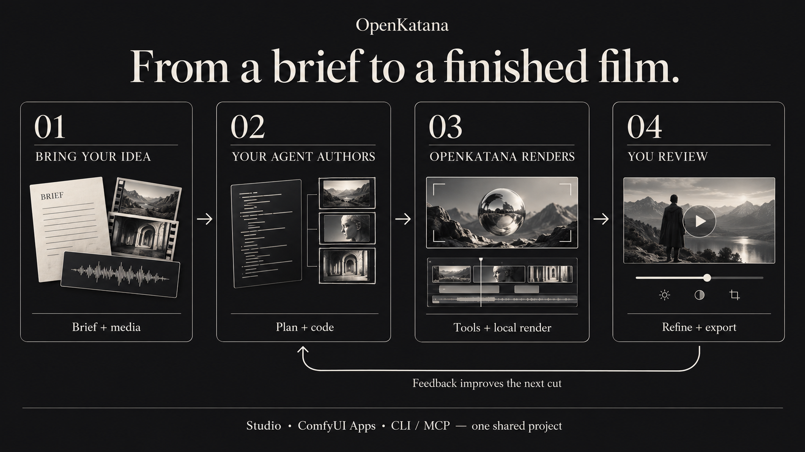
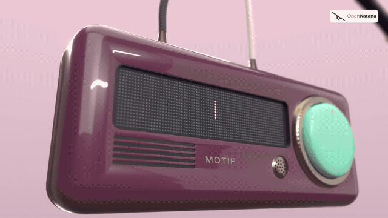

<p align="center">
  
</p>

# OpenKatana

An independent, open-source video editor inspired by Higgsfield's Katana, built
with the Comfy Developer Platform for
[#OpenSourceHiggsfield](https://comfy.org/open-source-higgsfield/).

**Your photos and videos, made into a finished edit with code.** OpenKatana is an
independent, open-source video editor for your AI agent: cuts, transitions, motion,
typography and music in one shared project, all made with code. Built with the
Comfy Developer Platform, with local open-weights workflows and optional authorized
API models. **Version 0.1.0.**



## What can you make?

Turn a folder of photos into a story, cut footage to music, animate typography,
or build a product film from a 3D scene. Your agent writes the edit and calls the
tools; you set the direction and refine the result in Studio.

- **Edits with rhythm:** cuts, speed ramps, transitions, camera moves, beat analysis,
  audio mixing and sound effects.
- **3D films and morphs:** code-authored WebGL scenes, materials, lights, camera paths,
  rigs and morphs, with an optional Blender rendering workflow.
- **Motion graphics:** animated lettering, multilingual text shaping, responsive
  layouts, masks and reusable effects.
- **Finishing:** frame previews, motion checks, HDR workflows and video export.
  Restoration and generation adapters use separately installed or authorized models.

OpenKatana offers **72 CLI/MCP tools** ([see them all](docs/TOOLS.md)). Your agent supplies the creative
decisions; OpenKatana executes them and keeps an editable project on your machine.

## How it works

1. **Bring a brief and media.** Describe the film, add footage, photos or music,
   or ask for an original scene made with code.
2. **Let your agent author it.** The agent plans shots, writes scene or animation
   code, and builds the timeline using OpenKatana's tools.
3. **Render locally.** Preview frames, render scenes and assemble the edit with
   typography, effects and sound.
4. **Review and refine.** Watch the result, give feedback, adjust it in Studio,
   and export when it is ready.



Studio, ComfyUI Apps, CLI and optional MCP work with the same project. You can
move between agent instructions and hands-on review without starting over.
The two illustrations explain the workflow; MOTIF below is an actual rendered film.

## See it in motion: MOTIF

[](docs/assets/motif-1080p60.mp4)

**[Watch or download MOTIF — 1080p, 60 fps, with sound](docs/assets/motif-1080p60.mp4)**

A 24-second product film with procedural 3D objects, choreographed cameras,
animated displays, typography and an original soundtrack. OpenKatana offers
code-authored WebGL rendering for 3D scenes, with a Blender option available too.
This MOTIF export used the Blender option; OpenKatana assembles and finishes the
film. No video-generation model was used. The GIF shows an eight-second preview
at reduced resolution and frame rate;
the MP4 preserves the original 1080p/60fps export and audio.
[Artwork and film credits](docs/assets/readme-visuals.json).

## Start with your agent

Use an agent that can read files and run commands on your computer.
**Copy and send this prompt:**

```text
Set up OpenKatana so you can create and edit videos for me with code.

1. Download the project with:
   git clone https://github.com/rk0neki/OpenKatana.git
2. Open the downloaded OpenKatana folder, read docs/SETUP.md,
   and run python scripts/setup.py.
3. Read the openkatana-video skill that setup installs for my first project.
4. If I use ComfyUI, install the OpenKatana nodes (docs/COMFY_APPS.md) and
   open the 00 Full workflow App first. Then check the required tools,
   open Studio, and tell me when it is ready.

Use the local CLI by default. Ask before downloading models, spending credits,
uploading files or publishing. Do not generate a video during setup.
```

Python 3.11+ and Git are required. Setup prepares the Python environment, first
project and agent skill. It checks for the rendering tools; FFmpeg and a supported
browser are separate installations. Blender and generative models are optional.
There is no OpenKatana login. [Full setup guide](docs/SETUP.md) ·
[Optional MCP setup](docs/AGENT_INTERFACE.md).

<details>
<summary><strong>Prefer to install it yourself?</strong></summary>

```sh
git clone https://github.com/rk0neki/OpenKatana.git
cd OpenKatana
python scripts/setup.py
```

Use `python3` if that is your Python 3.11+ command. Follow the exact next commands
printed by setup to open Studio. The [setup guide](docs/SETUP.md) explains the
browser and FFmpeg requirements and how to activate the environment.

Once set up, try an included edit without an AI account or model download:

```sh
python examples/quick-edit/render.py
```

This renders an eight-second edit from bundled images and original music.
[Preview and source credits](examples/quick-edit/README.md).

</details>

## Use it in ComfyUI

OpenKatana includes six saved Apps: **Full workflow**, which puts every App in one
graph, plus **Open Studio**, **All tools**, **Make a 3D scene**, **Background job**
and **Video to edit**. The integration offers 85 nodes for its tools plus project,
job and media helpers.

Connect a local model's image frames or video output to **Import media → Make edit
→ Render to video**, then open the same project in Studio to refine it.

After setup, ask your agent to follow the [ComfyUI Apps installation guide](docs/COMFY_APPS.md).
The Apps run locally; cloud and paid generation are disabled in that route.
Authorized model calls are available separately through the CLI/agent workflow.

For a tested model-to-edit example, see [LTX-2.5 → OpenKatana](examples/comfy/README.md):
Cloud generation followed by local speed ramp, freeze, typography and audio editing.
Its source clip is bundled, so repeating the local edit costs no credits.

## Documentation and compatibility

- [Setup](docs/SETUP.md) · [Studio](docs/STUDIO.md) · [Agent guide](docs/AGENT_INTERFACE.md) · [All tools](docs/TOOLS.md)
- [Timeline](docs/TIMELINE.md) · [Editor tools](docs/EDITOR_TOOLS.md) · [Effects](docs/EXPANSION.md)
- [3D](docs/SCENE3D.md) · [WebGL](docs/WEBGL.md) · [Blender](docs/ANIMATION.md)
- [Compositions](docs/COMPOSITIONS.md) · [HDR](docs/HDR.md) · [Models](docs/COMFY_MODELS.md)
- [Capabilities](docs/CAPABILITY-MATRIX.md) · [Limits](docs/CAPABILITY-GAPS.md) · [Validation](docs/VALIDATION.md)
- [Contributing](CONTRIBUTING.md) · [Skill](skills/openkatana-video/SKILL.md) · [Release notes](docs/RELEASE-NOTES.md)

CI covers Windows and Linux on Python 3.11 and 3.12; check the completed runs for
the commit you install. **macOS is untested.** FFmpeg, Chromium, optional Blender
and generative weights are separate installations. Studio is not a full graphical
3D scene editor. There is no hosting bill for the local app.

<details>
<summary>Experimental hosting and remote MCP</summary>

The [hosted pilot](docs/HOSTING.md) prepares account workspaces, queued rendering
and remote MCP. It is experimental and not deployed. Production identity,
isolation, backups and model services need deployment-specific validation.
See [security](SECURITY.md) and [hosting costs](docs/HOSTING-COSTS.md).

</details>

## Independence

OpenKatana is inspired by Higgsfield's Katana and is not affiliated with,
endorsed by, or sponsored by Higgsfield AI. It does not connect to Higgsfield's
services. Those names identify the inspiration; their use does not imply
endorsement or trademark rights. It contains no Higgsfield code, prompts,
presets or assets. The project and its bundled dependencies have
the licenses and source records linked below.

## License

OpenKatana uses [Apache-2.0](LICENSE). Bundled components retain their own licenses
and notices; see [NOTICE](NOTICE) and [third-party notices](THIRD_PARTY_NOTICES.md).
External software, models and media have separate terms. The project license
does not grant rights to them or guarantee legal clearance. See [licensing](docs/LICENSING.md).
