# Effects gallery

Every After Effects-style effect OpenKatana renders, one frame from each, with the timeline JSON that made it.
The frames come from [the effects reel](assets/ae-packs.mp4) (one second per effect, on an original test plate),
which `python examples/effects_reel.py` reproduces. Parameters and defaults are in [TIMELINE.md](TIMELINE.md); recipes
are in the [effects playbook](EFFECTS-PLAYBOOK.md). Try any effect on your own media with `preview_effect`, or in
ComfyUI with the **06 Preview an effect** App. In a timeline, an effect goes in a shot's `fx`, `layers` or `post`.

## Distort

| Frame | Effect | Timeline JSON |
|---|---|---|
| 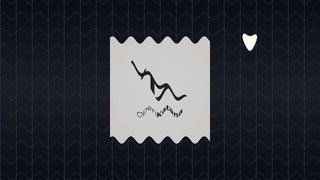 | **Wave Warp** `local_wave_warp` | `{"wave_height": [[0, 0, "ease"], [0.5, 22]], "wave_width": 110, "wave_speed": 2, "direction": 90}` |
| 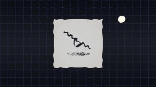 | **Ripple** `local_ripple` | `{"amplitude": [[0, 0, "ease"], [0.6, 14]], "wavelength": 60, "wave_speed": 2, "radius": 0.6}` |
| 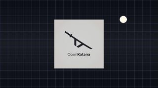 | **Shockwave** `local_shockwave` | `{"at": 0.0, "d": 1.0, "amount": 80, "width": 120, "split": 8, "max_radius": 0.7}` |
| 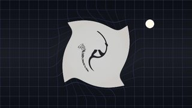 | **Twirl** `local_twirl` | `{"angle": [[0, 0, "ease"], [1, 240]], "radius": 0.45}` |
| 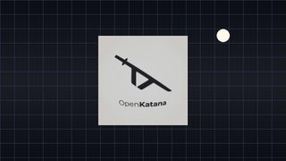 | **Bulge** `local_bulge` | `{"height": [[0, 0, "ease"], [0.45, 1.6, "ease"], [0.95, -1]], "horizontal_radius": 280, "vertical_radius": 280}` |
|  | **Polar Coordinates** `local_polar` | `{"interpolation": [[0, 0, "ease"], [0.9, 1]]}` |
| 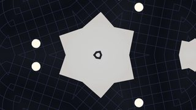 | **Kaleidoscope** `local_kaleidoscope` | `{"segments": 6, "rotation": [[0, 0], [1, 60]], "size": 900}` |
| 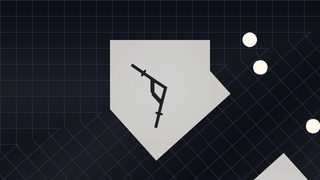 | **Mirror** `local_mirror` | `{"reflection_angle": [[0, 0, "ease"], [1, 90]]}` |
| 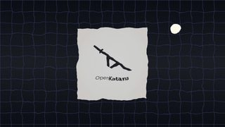 | **Turbulent Displace** `local_turbulent_displace` | `{"amount": [[0, 0, "ease"], [1, 40]], "size": 120, "complexity": 3, "speed": 1}` |

## Light

| Frame | Effect | Timeline JSON |
|---|---|---|
| 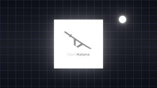 | **Deep Glow** `local_deep_glow` | `{"threshold": 0.6, "radius": [[0, 80, "ease"], [1, 360]], "exposure": [[0, 1, "ease"], [1, 4]], "layers": 8}` |
| 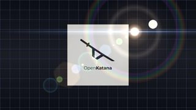 | **Lens Flare** `local_lens_flare` | `{"position": [[0, [0.15, 0.25], "ease"], [1, [0.85, 0.3]]], "brightness": 1.3, "streak": 0.6}` |
| 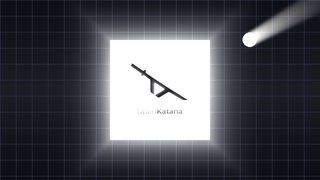 | **Light Rays** `local_light_rays` | `{"center": [0.5, 0.5], "intensity": [[0, 0.3, "ease"], [1, 1.6]], "length": 0.55, "threshold": 0.7}` |
| 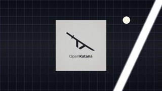 | **Light Sweep** `local_light_sweep` | `{"d": 1, "angle": 25, "width": 120, "intensity": 1.2}` |

## Time

| Frame | Effect | Timeline JSON |
|---|---|---|
| 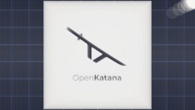 | **Echo** `local_echo` | `{"echo_time": -0.08, "number_of_echoes": 6, "starting_intensity": 0.8, "decay": 0.7, "operator": "screen"}` |
| 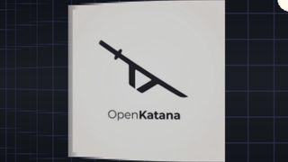 | **Time Displacement** `local_time_displacement` | `{"map": "horizontal", "max_displacement": 0.5, "levels": 12}` |
| 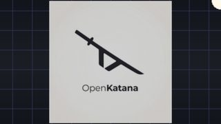 | **Posterize Time** `local_posterize_time` | `{"fps": 6}` |
| 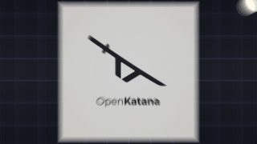 | **Frame Blend** `local_frame_blend` | `{"samples": 8, "shutter": 1}` |

## Blur & Sharpen

| Frame | Effect | Timeline JSON |
|---|---|---|
|  | **Gaussian Blur** `local_gaussian_blur` | `{"blurriness": [[0, 0, "ease"], [1, 40]]}` |
| 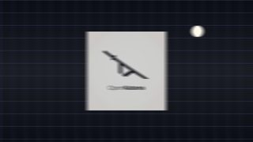 | **Directional Blur** `local_directional_blur` | `{"direction": 90, "blur_length": [[0, 0], [0.4, 80, "out2"], [1, 0, "ease"]]}` |
|  | **Radial Blur** `local_radial_blur` | `{"type": "zoom", "amount": [[0, 70], [0.8, 0, "out2"]], "center": [0.78, 0.22], "quality": "high"}` |
|  | **Camera Lens Blur** `local_camera_lens_blur` | `{"blur_radius": [[0, 0], [0.6, 35, "ease"]], "iris_shape": "hexagon", "highlight_gain": 50, "highlight_threshold": 250}` |
| 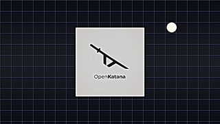 | **Unsharp Mask** `local_unsharp_mask` | `{"amount": [[0, 0], [1, 300]], "radius": 6}` |
| 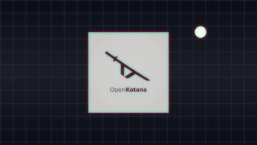 | **Channel Blur** `local_channel_blur` | `{"red_blurriness": [[0, 0], [1, 30]], "blue_blurriness": [[0, 0], [1, 12]]}` |
| 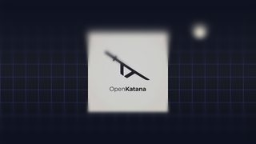 | **Tilt-Shift** `local_tilt_shift` | `{"center": [[0, 0.3], [1, 0.7, "ease"]], "band": 0.2, "blur_radius": 60, "saturation": 1.4}` |

## Stylize

| Frame | Effect | Timeline JSON |
|---|---|---|
| 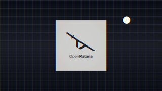 | **RGB Split** `local_rgb_split` | `{"amount": [[0, 0], [0.25, 60, "out3"], [1, 0]], "angle": 0}` |
| 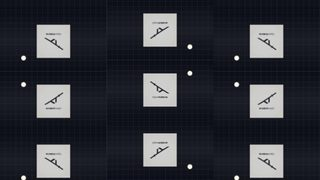 | **Motion Tile** `local_motion_tile` | `{"tile_width": [[0, 100], [0.5, 33.3, "inout"]], "tile_height": [[0, 100], [0.5, 33.3, "inout"]], "mirror_edges": true, "phase": [[0.5, 0], [1, 180]]}` |
| 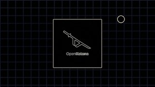 | **Find Edges** `local_find_edges` | `{"invert": true, "blend_with_original": [[0, 1], [0.5, 0]]}` |
| 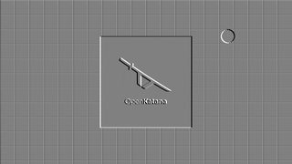 | **Emboss** `local_emboss` | `{"direction": [[0, 0], [1, 360]], "relief": 3, "contrast": 200}` |
| 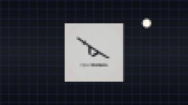 | **Mosaic** `local_mosaic` | `{"horizontal_blocks": [[0, 8], [1, 160, "in2"]], "vertical_blocks": [[0, 5], [1, 90, "in2"]]}` |
| 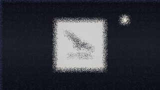 | **Scatter** `local_scatter` | `{"scatter_amount": [[0, 0], [0.5, 60], [1, 0]], "randomize_every_frame": true}` |

## Generate

| Frame | Effect | Timeline JSON |
|---|---|---|
| 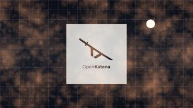 | **Fractal Noise** `local_fractal_noise` | `{"fractal_type": "turbulent_smooth", "tint": "#ffa060", "blend": "screen", "opacity": 0.55, "contrast": 150, "brightness": -20, "scale": 300, "speed": 0.3}` |
| 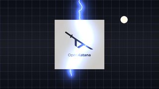 | **Advanced Lightning** `local_lightning` | `{"origin": [0.5, 0], "direction": [0.45, 0.85], "conductivity": [[0, 0], [1, 6]], "glow_opacity": 0.8, "glow_radius": 120, "flicker": 4, "blend": "add"}` |
| 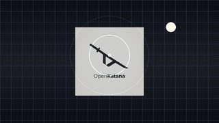 | **Radio Waves** `local_radio_waves` | `{"producer": [0.5, 0.45], "frequency": 3, "expansion": 500, "lifespan": 1, "end_width": 0, "stroke_color": "#80e0ff", "blend": "add"}` |
| 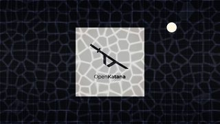 | **Cell Pattern** `local_cell_pattern` | `{"cell_pattern": "tubular", "size": 90, "speed": 0.5, "blend": "overlay", "opacity": 0.5}` |
| 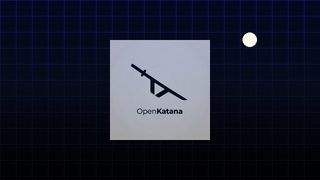 | **Gradient Ramp** `local_gradient_ramp` | `{"start": [0.5, 0], "start_color": "#2040a0", "end": [0.5, 1], "end_color": "#000000", "blend": "soft_light", "ramp_scatter": 0.3}` |
| 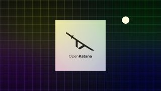 | **4-Color Gradient** `local_four_color_gradient` | `{"blend": "overlay", "opacity": 0.7, "point_1": [[0, [0.1, 0.1]], [1, [0.3, 0.2]]]}` |
| 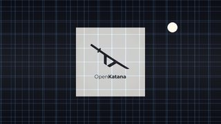 | **Grid** `local_grid` | `{"width": 120, "border": 2, "color": "#60c0ff", "blend": "add", "opacity": 0.5, "anchor": [[0, [0.5, 0.5]], [1, [0.6, 0.5]]]}` |
