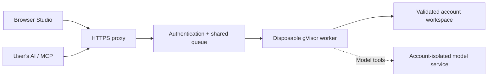

# Hosted OpenKatana

The hosting preparation adds a browser editor and authenticated remote MCP.
Visitors upload media and bring their AI; no checkout, Python or local rendering
installation is needed. The operator installs the server. Nothing is deployed
by the setup scripts or CI.

The default pilot has ten accounts, one active worker, eight pending jobs per
account, 2 GiB workspaces, 256 MiB uploads and thirty-minute jobs. Extracted
frames use much more storage than compressed videos. Benchmark before raising
these limits or promising rendering speed.

## Shared tools

All 72 AgentAPI operations have hosted schemas, plus four file/preview helpers
and two MCP queue helpers. Actual availability depends on installed models and
services. Browser **Tools → Run tool** and MCP use the same account workspace.

- Upload through **Files** or the media picker. Downloads require the same account.
- Agents use `workspace://` paths and `list_project_files`.
- Author scenes/scripts/workflows with `write_project_file`. Replacements require
  the SHA-256 returned by `read_project_file`. Timelines use `save_timeline` and
  its revision guard.
- Poll `get_tool_job` until completion; queued is not success. Cancellation and
  restart never automatically retry uncertain model submissions.
- Previews run inside workers. User-authored JavaScript is not executed in the
  signed-in browser. Scrubbing requests server stills; rendered videos play motion/audio.

The web process has no Docker access. Workers have read-only input, bounded
tmpfs and CPU/memory/process/time limits, without internet access. Exports reject
links, traversal and excessive size. Final workspace replacement is serialized
with uploads/cancellation. Use a dedicated patched host: these controls are not
a security audit. Read [Docker security](https://docs.docker.com/engine/security/)
and [gVisor production guidance](https://gvisor.dev/docs/user_guide/production/).

## Connect an AI

**Connect AI** supplies `https://YOUR_DOMAIN/mcp` using the official SDK's
Streamable HTTP transport. Pilot clients can use revocable seven-day bearer
keys in private Authorization-header configuration. Never publish keys.

OAuth-only clients require an external authorization server. OpenKatana offers
resource metadata and verifies RS256 tokens against issuer, JWKS, audience and
`openkatana` scope. Browser sign-in uses PKCE. Configure and test the provider's
client registration/discovery, callbacks and audience with the actual AI clients;
this is not a universal platform connector. See [MCP remote servers](https://modelcontextprotocol.io/docs/develop/connect-remote-servers).
Users supply their own AI subscriptions.

## Models and remaining deployment work

CPU editing, WebGL and Blender need no generation provider. Segmentation,
transcription, generation, identity transfer and learned restoration require
their packages/weights. The base image downloads no generation weights.

Private Comfy services use separate `{user}` endpoints/internal networks for
multiple accounts. Shared unauthenticated Comfy is not a tenant boundary. The
operator provisions reviewed nodes and licensed models. Never allow public access to raw ports.

**Paid cloud execution is disabled in this hosted pilot.** Its local CLI option
is unchanged. Online paid providers still require a credential broker, explicit
per-user authorization and enforceable spending limits. Do not inject provider
keys into authored-code workers. A listed tool does not mean every model is online.

See [deployment](../deploy/README.md) and [budget](HOSTING-COSTS.md). Hosting CI
builds the real worker and exercises HTTP/MCP, editing, WebGL, downloads and the
browser, plus Blender Cycles and the reusable animation kit. Check its result
for the deployment commit. Fixtures do not validate
production load or every model/provider. Do not make local Studio publicly accessible;
use this authenticated entry point. Local setup remains in [SETUP.md](SETUP.md).
